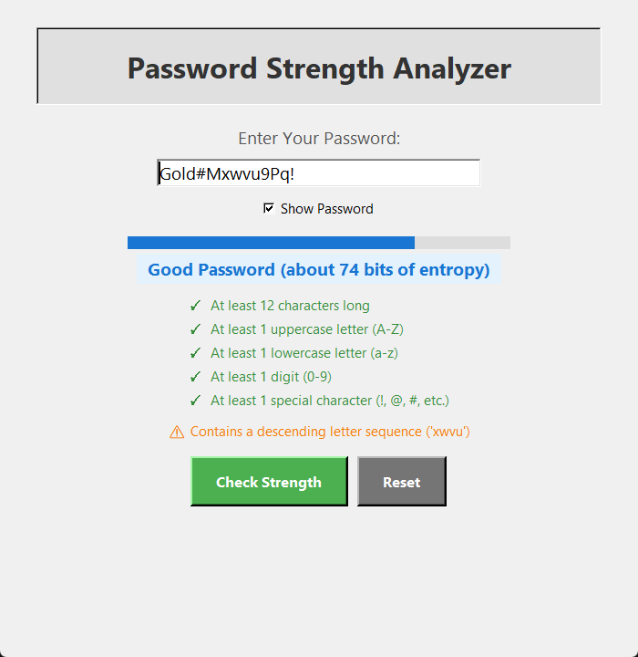

# Password Strength Tester

A modern, user-friendly Python application to check the strength of your passwords. Built with Tkinter, it gives live feedback as you type, rates how hard your password is to guess, and can check whether it has appeared in a known data breach.



---

## Features

- **Live feedback as you type**: strength meter, rating and requirements checklist update instantly
- **Strength rating** (Weak / Fair / Good / Strong) based on estimated entropy
- **Requirements checklist** with ✓ / ✗ for each rule:
  - Minimum length (12+ characters)
  - Uppercase, lowercase, digit and special character
  - Passphrases of 20+ characters skip the character-type rules, following [NIST SP 800-63B](https://pages.nist.gov/800-63-3/sp800-63b.html) guidance that length matters more than complexity
- **Weak pattern detection**:
  - Repeated characters (e.g., "aaa", "111")
  - Letter and digit sequences (e.g., "abc", "987")
  - Keyboard patterns (e.g., "qwerty", "asdf", "1qaz")
  - Common passwords and words, including leetspeak variants (e.g., "P@ssw0rd123!")
- **Data breach check** using the [Have I Been Pwned](https://haveibeenpwned.com/Passwords) Pwned Passwords API
- **Show/Hide password toggle**, tooltips with the password requirements, and keyboard shortcuts

---

## How to Run

1. **Clone or download this repository.**
2. Make sure you have Python 3.8+ installed.
3. Run the app:
    ```sh
    python PST.py
    ```

---

## Usage

1. Type your password in the input field. The meter, rating, checklist and any warnings update as you type.
2. Hover over the label or entry for the password requirements.
3. Click **Check Strength** (or press **Enter**) to check the password against known data breaches.
4. Use the **Show Password** checkbox to toggle visibility.
5. Click **Reset** (or press **Esc**) to clear the input and results.

---

## How It Works

- **Entropy estimate**: each random character adds bits based on the size of the character pool used (lowercase, uppercase, digits, symbols). Characters that are part of a guessable pattern (common word, keyboard run, sequence, repeat) only add a small fixed amount, because attackers try those patterns first.
  - Weak: under 45 bits · Fair: 45–59 · Good: 60–74 · Strong: 75+
  - Passwords that fail a requirement or are based on a common password are always rated Weak.
- **Breach check privacy**: the password never leaves your computer. The app sends only the first 5 characters of the password's SHA-1 hash to the API, which returns every breached hash starting with those characters, and the match is done locally ([k-anonymity](https://www.troyhunt.com/ive-just-launched-pwned-passwords-version-2/#cloudflareprivacyandkanonymity)). This check needs an internet connection; everything else works offline.

---

## Project Structure

| File | Purpose |
|---|---|
| `PST.py` | Tkinter GUI |
| `password_checker.py` | Password checking logic (no GUI code, so it can be tested and reused) |
| `tests/test_password_checker.py` | Unit tests |

---

## Running the Tests

```sh
python -m unittest
```

The tests don't need an internet connection; the breach API is mocked.

---

## Building a Windows .exe (optional)

To share the app with people who don't have Python installed, you can package it with [PyInstaller](https://pyinstaller.org/):

```sh
pip install pyinstaller
pyinstaller --onefile --windowed --name PasswordStrengthTester PST.py
```

The executable is created in the `dist/` folder.

---

## Requirements

- Python 3.8+
- No external dependencies (uses the standard library only)

---

## Customization

- Add more entries to `COMMON_PASSWORDS` in `password_checker.py` for even better protection.
- Adjust `MINIMUM_LENGTH`, `PASSPHRASE_LENGTH` and the `RATINGS` thresholds in `password_checker.py`.
- The UI colours and text can be customized at the top of `PST.py`.

---

## License

This project is licensed under the MIT License. See [LICENSE](LICENSE).

---

## Author

- Pratham Pabuwal

Linkedin: https://www.linkedin.com/in/pratham-pabuwal/

---

*Feel free to contribute!*
